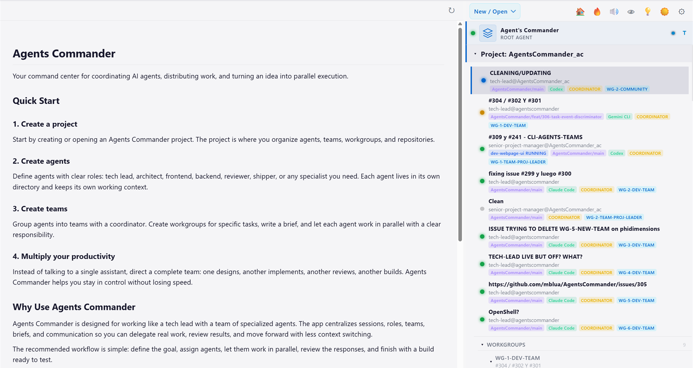

<p align="center">
  
</p>

<h1 align="center">Agents Commander</h1>

<p align="center">
  <b>Turn what you learn into an agent ecosystem you can reuse.</b> For developers working solo or in Teams: keep roles, skills, and recorded experience in your repository, refine them from real work, and bring the setup to your next task. Your coding agents run in real terminals; you decide how they work together.
</p>

<p align="center">
  <a href="https://github.com/mblua/AgentsCommander/releases/latest"></a>
  <a href="https://github.com/mblua/AgentsCommander/actions/workflows/release.yml"></a>
  <a href="LICENSE"></a>
  <a href="https://github.com/mblua/AgentsCommander/stargazers"></a>
  <a href="CODE_SIGNING_POLICY.md"></a>
  <a href="https://tauri.app"></a>
  <a href="https://app.codecov.io/gh/mblua/AgentsCommander/tree/main">Frontend coverage </a>
</p>

Frontend coverage shows the latest successfully processed frontend report. Badges can cache or lag; compare the report commit and date with `main`.

<p align="center">
  <a href="#install-with-a-coding-agent"><b>Install with a Coding Agent</b></a>
  &nbsp;·&nbsp;
  <a href="docs/install-with-agent.md#support-gates"><b>Platform support</b></a>
  &nbsp;·&nbsp;
  <a href="docs/install-with-agent.md#manual-alternatives"><b>Manual install</b></a>
  &nbsp;·&nbsp;
  <a href="#60-second-quickstart"><b>▶ Quickstart</b></a>
</p>

---

## Installation

<a id="install-with-a-coding-agent"></a>

### Install with a trusted Coding Agent

Paste this prompt into a Coding Agent you already trust. It inspects first, shows you an exact plan, and waits before changing your machine.

```text
Install AgentsCommander safely using only the official `mblua/AgentsCommander` repository, its latest stable GitHub Release, and the canonical guide: https://github.com/mblua/AgentsCommander/blob/main/docs/install-with-agent.md

First resolve/report the current `main` snapshot's full commit SHA, then read the guide at that pinned commit. Treat the entire pinned guide, especially `Support gates`, `Use only pinned official evidence`, `Storage, backup, and upgrades`, and `Coding Agent contract`, as binding. Fail closed on every stop condition and on missing, ambiguous, or conflicting required evidence.

Before any download or mutation, perform/report every required read-only preflight and the complete plan: OS/version/architectures/support tier and Linux distribution; existing install/version/provenance; independently resolved target stable tag; storage, backup, upgrade, and uninstall-state requirements from the canonical owner https://github.com/mblua/AgentsCommander/issues/1118 (`main` is not published-binary evidence); mapped release/asset URLs and exact checksum record; destination, commands, created/overwritten files, privilege, PATH/system-wide effects, preservation, validation, and rollback. Apply the guide's gates exactly: Windows 10 1809+/11 x86_64/AMD64 is full; Linux x86_64/AMD64 is supported with medium test coverage and requires the limitations explained plus explicit confirmation; macOS is supported via npm only with very low test coverage, so warn that errors are expected, get explicit confirmation, and use no other macOS route; all other platforms stop. On Linux, identify the distro from read-only OS information using ID first, then recognized ID_LIKE family tokens: Debian/Ubuntu selects DEB, Fedora/RHEL selects RPM, other Linux selects AppImage. Conflicting family evidence or a missing exact mapped asset stops. Prefer least privilege. Await plan approval plus separate consent for elevation, system-wide/PATH changes, overwrites, and unsigned execution.

Only afterward follow the guide's exact same-release download, one-record full-SHA-256 verification, data preservation under #1118, approved execution, exact-path validation/reporting, and rollback rules. Stop an existing-install update or uninstall if canonical guidance is insufficient; do not invent storage or migration behavior. Warn that Windows artifacts and the macOS `.app` bundle may be unsigned, and that a matching release checksum detects corruption/asset mismatch, not publisher/repository-account compromise. Enforce all prohibitions: silent security bypass, automatic elevation, `curl | shell`, mirrors, source fallback, emulation/substitute assets, npm fallback outside the macOS route, and installing/authenticating a Coding Agent CLI for me.
```

Read the complete [installation contract, platform matrix, trust boundaries, and rollback rules](docs/install-with-agent.md). Prefer a manual release download, or npm? See the [other routes](docs/install-with-agent.md#manual-alternatives), including the npm-only macOS route, under the same platform policy.

## The 30-second pitch

> **Build a coding-agent setup that keeps the lessons from your work.** Start with one agent and refine its role, skills, and written notes, or define a Team and activate it as a Room for each task. Review the outputs and messages, update the reusable files, and carry those changes into the next task. You choose what to record and improve; this is an explicit workflow, not automatic learning.

- **Bring your coding agents and model access.** Claude Code, Codex, Antigravity, and Pi have dedicated integrations; you can configure other shell-based CLIs, including OpenCode, through custom agents. Each session runs in a real PTY. You supply the CLI, account, and authentication; custom commands do not necessarily support every integration feature.
- **Direct multiple Rooms from the Root Agent.** The Agent Commander / Root Agent gives you one place to steer work across Teams. Ask it to talk to Room orchestrators, send work to different Teams, and keep initiatives aligned across parallel Rooms.
- **Give each Room its own working copies.** AC creates a separate workspace with repository clones, agent replicas, a messaging area, and build or test state. Each agent's context carries write-restriction instructions that ask it to stay inside its Room; that is documented policy the agents follow, not a sandbox the product enforces. Each session invokes the installed AgentsCommander executable with credentials whose token and root values are scoped to that Room. Run multiple Teams, or multiple Rooms for the same Team, without mixing one task's source changes or build and test state into another's.
- **Return without rebuilding the map.** A Room keeps its task, agent replicas, repository clones, and messages on disk. Come back later, reopen a Room's closed session, and AC asks Claude Code, Codex, Antigravity, or Pi to continue the prior conversation in that same workspace.
- **Continue from a written handoff.** With a compatible CLI, an agent can write `SELF-HANDOFF.md`, request a context clear, and continue from that note. Clearing is best-effort and depends on the provider mapping; unrecognized shell wrappers are unsupported. The note records what to carry forward rather than preserving the entire conversation automatically.
- **Share configuration as source code.** A Project's `.ac/` tree holds canonical agent roles, skills, and plans; Team rosters and repo access; and Loop prompts and schedules in reviewable Markdown, JSON, and TOML. Commit the shared files so teammates can pull the same reviewed setup instead of recreating it.
- **Coordinate Teams through auditable files.** Agents exchange Markdown messages in a `messaging/` folder you can read with `cat`, inspect in an editor, search, and audit directly on disk. The whole organization fits in `ls`.
- **Phone-ready updates with images.** The Telegram bridge can stream session output and send photos or screenshots captured by agents, so remote status can include the actual screen or report.
- **Local state, no telemetry.** Shared team state stays in each project's `.ac/` tree. Follow the [canonical storage, backup, upgrade, and uninstall-state contract](https://github.com/mblua/AgentsCommander/issues/1118) before moving or deleting application state.

You bring the coding agents. AgentsCommander coordinates them.

## See it work

<p align="center">
  
</p>

<a id="60-second-quickstart"></a>

## Quickstart: first team

1. **Install and validate** AgentsCommander with the [reviewable Coding Agent plan](#install-with-a-coding-agent). If you choose a secondary route, follow the [canonical platform and trust rules](docs/install-with-agent.md). Start the validated executable from its approved location.
2. **Open a project**: click `New Project` in the sidebar and point it at an empty folder. AC creates a Project AC Root (`.ac/`) there.
3. **Create a Team**: add an orchestrator and one worker agent, each with a role prompt. [Teams and rooms](docs/agents/teams-and-workgroups.md) walks through this.
4. **Launch the orchestrator**: pick Claude Code, Codex, Antigravity, Pi, or OpenCode from the dropdown. Ask it to send the worker a hello message. The worker terminal receives a file notification and responds in real time.

Full walkthrough: [`docs/quickstart.md`](docs/quickstart.md).

## Why this exists

The useful part of a session can outlast its conversation: a clearer role, a tested skill, a recorded failure, or a better brief. AgentsCommander gives you a place to keep and refine that experience as plain files alongside your project. Use one agent day to day or organize Teams for different tasks; review their work and decide which changes belong in your reusable setup.

Your coding agents keep their own tools and run as real OS processes. AgentsCommander adds terminal sessions, Rooms, and inspectable Markdown messaging around them. Share reviewed configuration through Git while keeping credentials and machine-local runtime state separate.

## What you can build

| Use case | Setup |
|---|---|
| **A reusable solo setup** | Give one agent a role and skills, record useful lessons in notes, and revise those files as you learn what works. |
| **Parallel feature development** | Activate one Room per parallel task, even when reusing the same Team. Every Room gets its own repository clones and build or test state; direct the Room orchestrators from the Root Agent. |
| **Code-review swarm** | One agent ships a PR; two others review independently. You read both reviews in their own terminals before merging. |
| **Coordinated refactor Team** | Assign an orchestrator and workers to a multi-file refactor. Have agents run tests, inspect failures, and propose fixes using their own tools. |
| **Compare agent setups** | Manually rerun the same brief with different roles, skills, or CLI profiles, then compare terminal output, messages, test results, and diffs. You make the comparison; AC does not score the runs. |
| **Long-running agent with phone alerts** | Pair a session with a [Telegram bot](docs/features/telegram-bridge.md), kick off a build from your phone, and receive text updates plus screenshots or image artifacts. |

Recipes for parallel development, review, refactoring, and Telegram: [`docs/use-cases.md`](docs/use-cases.md).

## How it compares

| | AgentsCommander | LangGraph | AutoGen / AG2 | CrewAI | Aider | Claude Code alone |
|---|---|---|---|---|---|---|
| **Operates real CLI coding agents** | ✅ Claude Code, Codex, Antigravity, Pi, OpenCode | ❌ Python LLM calls | ❌ Python conversation | ❌ Python library | Partial (one agent) | ✅ (one agent) |
| **Real PTY per agent** | ✅ ConPTY / Unix PTY | ❌ | ❌ | ❌ | ✅ | ✅ |
| **Filesystem-first messaging** | ✅ Markdown in `messaging/` | ❌ DB / Python state | ❌ Python objects | ❌ Python tasks | n/a | n/a |
| **Standalone runtime** | ✅ Rust / Tauri | ❌ Python library | ❌ Python library | ❌ Python library | ❌ Python app | ✅ standalone CLI |
| **Multi-agent on the same repo** | ✅ | Partial | Partial | Partial | ❌ | ❌ |
| **Desktop UI** | ✅ Tauri app | ❌ | ❌ | ❌ | TUI only | TUI only |

Full comparison with trade-offs and honest losses: [`docs/comparison.md`](docs/comparison.md).

## Design principles

These are not accidents.

- **Start with files and CLIs.** AgentsCommander keeps the core workflow in plain files and real terminal sessions.
- **Configuration is source code.** Canonical agent, Team, and Loop configuration lives in plain Markdown, JSON, and TOML under each Project's `.ac/` tree. Commit those shared files and review them like code. Gitignored runtime and machine-local state (Rooms, Loop state, and project-local settings) can also live under `.ac/`; keep it distinct from the versioned configuration.
- **Files before databases.** Shared configuration and inter-agent messages use plain files that are easy to inspect and debug. Databases can be introduced for performance-critical runtime paths without hiding how a Team is defined or how its agents coordinate.
- **One agent = one directory.** An agent is defined by a `CLAUDE.md` file (or equivalent role-prompt file) inside its own directory. Multiple role prompts within the same directory or its subdirectories are forbidden. Coding agents assume the entire contents of their working directory are relevant context; if two role prompts coexisted, an agent could read another agent's role and leak context.

## Documentation

- [Install with a Coding Agent](docs/install-with-agent.md): platform gates, approved assets, checksum verification, and rollback
- [Quickstart](docs/quickstart.md): installed app to first running agent
- [Concepts](docs/concepts.md): agent, team, room, orchestrator, brief
- [Teams and rooms](docs/agents/teams-and-workgroups.md): orchestrators, members, briefs, messaging
- [Features](docs/features/): [Coding Agent Profiles](docs/features/coding-agent-profiles.md), [Session auto-close](docs/features/session-auto-close.md), [Config seed](docs/features/config-seed.md), [Seed manifest](docs/features/seed-manifest.md), [Container coding agents](docs/features/container-coding-agents.md), Telegram bridge with image and screenshot sends, voice-to-text, portable instances
- [Reference](docs/reference/): full CLI, `settings.json` schema, architecture, log filtering
- [Roadmap](ROADMAP.md) · [Changelog](CHANGELOG.md) · [Docs style guide](docs/style-guide.md)

## Platform support

| Platform | Native architecture | Status |
|---|---|---|
| **Windows 10 1809+ / Windows 11** | x86_64 / AMD64 | Fully supported; primary development and release-validation platform. |
| **Linux** | x86_64 / AMD64 | Supported with medium test coverage; some features are untested or unsupported, so expect some turbulence. Confirm the limitation before installing. |
| **macOS** | Any | Supported via npm only, with very low test coverage; errors are expected. |
| **Other combinations** | Any | Unsupported; do not substitute assets or use emulation as an install fallback. |

An artifact on a release is not a support promise. The [canonical installation guide](docs/install-with-agent.md) defines the operational gates and lists verified Windows-only features.

## Trust

AgentsCommander does not collect telemetry, analytics, or usage data. Optional features (Telegram Bridge, Voice-to-Text, and Jev classification for [Co-managed rooms](docs/features/co-managed-rooms.md), which sends captured agent text only when the global `coManagedEnabled` switch, off by default while in development, is on, a room's flag is on and a Jev key is set) transmit data to external services only when you enable them; see [`PRIVACY.md`](PRIVACY.md). Windows code signing is planned through [SignPath Foundation](https://signpath.org) with free signing courtesy of [SignPath.io](https://signpath.io), but current Windows release artifacts may be unsigned until [epic #717](https://github.com/mblua/AgentsCommander/issues/717) is complete. Verify the exact downloaded asset against the same release's `SHASUMS256.txt`; on Windows you can inspect signature status separately with:

```powershell
Import-Module (Join-Path $PSHOME "Modules\Microsoft.PowerShell.Security\Microsoft.PowerShell.Security.psd1") -ErrorAction Stop
Get-AuthenticodeSignature -LiteralPath ".\Agents.Commander_<version>_x64-setup.exe"
```

A release checksum detects corruption or a file that differs from the release record. It does not protect you if an attacker can replace both the asset and checksum through a compromised publisher or repository account. Full verification steps are in the [installation guide](docs/install-with-agent.md#verify-a-downloaded-asset-manually); signing policy is in [`CODE_SIGNING_POLICY.md`](CODE_SIGNING_POLICY.md).

## Community

- **Discuss setups and share what you learn**: join the [official Discord](https://discord.gg/EcwW5KvDCy).
- **Watch videos**: [Mariano Blua on YouTube](https://www.youtube.com/@marianoblua).
- **Questions, ideas, show-and-tell**: [GitHub Discussions](https://github.com/mblua/AgentsCommander/discussions).
- **Bug reports, feature requests**: [GitHub Issues](https://github.com/mblua/AgentsCommander/issues).
- **What's next**: [`ROADMAP.md`](ROADMAP.md).

### Help extend Linux and macOS support

Linux is supported with medium test coverage and macOS via npm with very low test coverage. Both tiers need the reports that turn gaps into fixes. If either platform misbehaves, file a reproducible [GitHub issue](https://github.com/mblua/AgentsCommander/issues) with your OS version, native architecture, AgentsCommander version or exact release asset, exact steps, expected result, actual result, and relevant sanitized logs. Contributors can follow [`CONTRIBUTING.md`](CONTRIBUTING.md); the [installation guide](docs/install-with-agent.md#help-extend-linux-and-macos-support) has a copyable report template.

## Contributing

See [`CONTRIBUTING.md`](CONTRIBUTING.md): branch naming, local build, log-filter setup, and the docs style guide.

## Acknowledgments

AgentsCommander stands on the shoulders of:

- **[@msitarzewski/agency-agents](https://github.com/msitarzewski/agency-agents)**: community library of agent role templates. AC can download an explicit, offline cache with `agency-templates update`; normal startup and role browsing never hit the network. Big thanks to the maintainers for keeping it open.

Also: Tauri, SolidJS, xterm.js, portable-pty, axum, tokio; the toolchain layer this app would be impossible without.

## Author

Mariano is passionate about software development, AI, and blockchain. He approaches the world with deep curiosity, always amazed by life and the universe. Above all, he is a father, which remains the most wonderful part of his life.

**Mariano Blua**: [GitHub](https://github.com/mblua) · [LinkedIn](https://www.linkedin.com/in/mariano-blua/) · [🇦🇷 MarianoBlua](https://x.com/MarianoBlua) · [🇺🇸 MarianoBluaEN (English)](https://x.com/MarianoBluaEN)

## License

[MIT](LICENSE)
